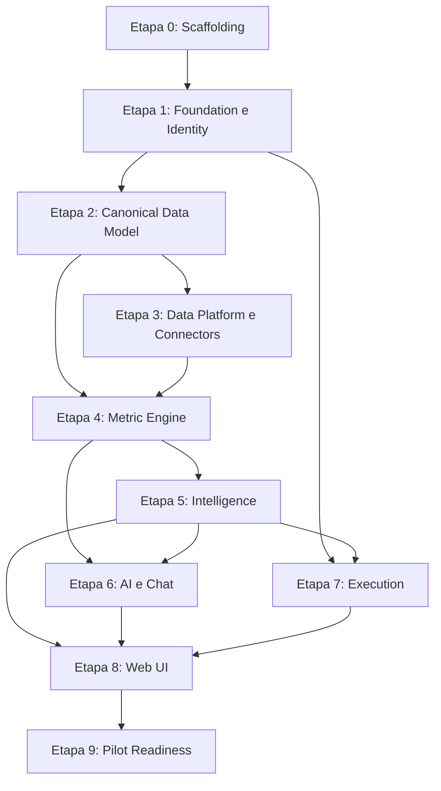

# Tactia Core V0.1 — Plano de Execução

**Base:** [spec.md](spec.md) (v0.1)
**Formato:** 10 etapas sequenciais (com paralelismo indicado), cada uma projetada para ser executada por um agente autônomo.
**Regra geral:** cada etapa só é considerada concluída quando seus critérios de aceite passam e o build/testes do monorepo continuam verdes.

---

## Decisões técnicas fixadas

A spec deixa algumas escolhas em aberto. Para eliminar ambiguidade entre agentes, ficam decididas:

| Tema | Decisão | Justificativa |
|---|---|---|
| Estrutura | Monorepo pnpm workspaces + Turborepo | Espelha a estrutura sugerida na seção 8 da spec |
| API | Next.js Route Handlers em `apps/web` (sem `apps/api` separado na V0.1) | Spec permite começar em projeto único; menos infra |
| ORM | Prisma + PostgreSQL 16 | Definido na spec |
| Auth | Better Auth (self-hosted) com adapter próprio na camada de domínio | Domínio desacoplado do provider, como exige a seção 7 |
| Filas | pg-boss (fila sobre PostgreSQL) | Spec seção 46: fila simples em Postgres antes de Redis |
| Validação | Zod em todas as fronteiras (API, tools, actions) | Spec seções 45, 49 |
| Logs | Pino (JSON estruturado) com `request_id`, `tenant_id`, `user_id` | Spec seção 47 |
| LLM | Vercel AI SDK com adapter próprio (`LLMAdapter`), provider via env | IA plugável, sem acoplamento |
| Criptografia de credentials | AES-256-GCM com chave em `ENCRYPTION_KEY` (env) | Spec seções 20, 49 |
| Storage | Interface `ObjectStorage` com driver S3-compatible (MinIO no docker local) | Spec seção 7 |
| IDs | UUID v7 em todas as tabelas | Spec seção 50 |
| Testes | Vitest (unit + integração com Postgres via docker) | Padrão do ecossistema |

### Estrutura de pastas alvo

```text
tactia/
├── apps/
│   └── web/                  # Next.js: UI + /api/v1/* route handlers
├── packages/
│   ├── database/             # Prisma client, schema, migrations, repositories
│   ├── domain/               # Entidades, services, regras de negócio, erros
│   ├── connectors/           # Interface Connector + CSV + Postgres
│   ├── intelligence/         # Metric/Rule/Insight/Recommendation engines
│   ├── execution/            # Action engine, approvals
│   ├── ai/                   # Tool registry, context builder, LLM adapter, orchestrator
│   └── shared/               # Zod schemas, logger, erros, utils, tipos
├── docker/                   # docker-compose (postgres, minio)
└── docs/                     # documentos gerados por etapa
```

### Convenções obrigatórias (valem para todas as etapas)

1. **Tenant isolation:** todo repository recebe `{ tenantId, ... }` como argumento obrigatório. Nunca aceitar `tenant_id` do frontend; derivar da sessão (spec seção 34).
2. **Erros classificados:** usar os códigos da spec seção 48 (`VALIDATION_ERROR`, `NOT_FOUND`, etc.). Nunca expor stack trace.
3. **AuditLog:** toda operação relevante grava audit log (spec seção 33).
4. **Índices:** `tenant_id`, `external_id`, `created_at`, `status` e combinações frequentes (spec seção 50).
5. **Soft delete** (`deleted_at`) em Customer, Product, Seller, DataSource, User/Membership (spec seção 51).
6. **Determinístico antes de IA:** métricas e regras 100% em código; LLM só interpreta/explica (spec seção 3.4).
7. Cada agente atualiza `docs/etapa-XX.md` com o que foi entregue e decisões tomadas.

---

## Mapa de dependências



Paralelismo possível: E4 pode começar junto com E3 (usando dados de seed); E7 pode rodar em paralelo com E6.

---

## Etapa 0 — Scaffolding do Monorepo

**Depende de:** nada.
**Missão do agente:** criar a fundação do repositório para todos os outros agentes.

### Escopo

- Monorepo pnpm + Turborepo com `apps/web` (Next.js + TypeScript strict) e todos os `packages/*` vazios porém compiláveis.
- `docker/docker-compose.yml` com PostgreSQL 16 e MinIO.
- `packages/database` com Prisma configurado, migration inicial vazia e script de seed.
- `packages/shared` com: logger Pino, classe `AppError` + códigos de erro da spec seção 48, helper de resposta de API padronizada, utilitário UUID v7.
- ESLint + Prettier + tsconfig base compartilhado.
- `.env.example` documentando todas as variáveis (`DATABASE_URL`, `ENCRYPTION_KEY`, `LLM_API_KEY`, `S3_*`).
- README com instruções de setup (`pnpm install`, `docker compose up`, `pnpm db:migrate`, `pnpm dev`).
- CI mínimo (GitHub Actions): lint + typecheck + test + build.

### Critérios de aceite

- `pnpm install && pnpm build && pnpm test` verdes a partir de clone limpo.
- `docker compose up` sobe Postgres e MinIO; migration aplica sem erro.

---

## Etapa 1 — Foundation e Identity

**Depende de:** Etapa 0.
**Missão do agente:** implementar autenticação, multi-tenancy e auditoria — a base de segurança de tudo.

### Escopo

- Modelos Prisma + migrations: `Tenant`, `User`, `Membership`, `AuditLog` (spec seções 9–11, 33), com enums de status/roles conforme spec.
- Better Auth integrado em `apps/web`, com adapter para `User` (campo `external_auth_id`).
- Contexto de requisição: middleware que resolve sessão → usuário → tenant ativo → role, e injeta `RequestContext { requestId, tenantId, userId, role }` em todos os handlers `/api/v1/*`.
- Autorização server-side básica por role (owner/admin/member/viewer) — sem sistema complexo de permissões (fora de escopo, spec seção 5).
- Repositories e services em `packages/domain`: criar tenant, criar usuário, convidar/gerenciar membership.
- Rotas: `/api/v1/auth/*`, `/api/v1/tenants`, `/api/v1/users`, `/api/v1/memberships`.
- `AuditLogService` central (usado por todas as etapas seguintes) gravando eventos como `USER_CREATED`.
- Rate limiting básico nas rotas de auth.
- Rota `/api/v1/audit-logs` (leitura, restrita a owner/admin).
- Testes de integração provando isolamento: usuário do tenant A recebe `NOT_FOUND`/`AUTHORIZATION_ERROR` ao acessar recurso do tenant B.

### Critérios de aceite (spec seção 59 — Tenant)

- Criar empresa, criar usuários, login funcional.
- Teste automatizado de isolamento entre tenants passando.
- Audit logs gravados para signup/criação de tenant/membership.

---

## Etapa 2 — Canonical Data Model

**Depende de:** Etapa 1.
**Missão do agente:** implementar as 7 entidades canônicas de negócio com CRUD completo e isolamento por tenant.

### Escopo

- Modelos Prisma + migrations: `Customer`, `Lead`, `Product`, `Seller`, `Sale`, `SaleItem`, `Activity` (spec seções 12–18), com todos os campos, enums de status e relacionamentos da spec.
- Constraint única `(tenant_id, data_source_id, external_id)` onde aplicável (preparação para upsert idempotente da Etapa 3, spec seção 38).
- Índices obrigatórios e soft delete conforme convenções.
- Repositories em `packages/database` (todos exigindo `tenantId`), services em `packages/domain` com validação Zod.
- Rotas CRUD: `/api/v1/customers`, `/leads`, `/products`, `/sales` (com itens aninhados), `/sellers`, `/activities` — com paginação, filtros por status e busca simples.
- Audit log em create/update/delete.
- Seed de desenvolvimento: 1 tenant demo com ~200 customers, ~50 products, ~10 sellers, ~1000 sales distribuídas nos últimos 6 meses (essencial para as Etapas 4–6 testarem métricas e regras com dados realistas, incluindo uma queda de receita proposital nas últimas semanas).
- Testes de integração de CRUD + isolamento para cada entidade.

### Critérios de aceite

- CRUD completo das 7 entidades via API, isolado por tenant.
- Seed popula dados realistas com um cenário de anomalia embutido.

---

## Etapa 3 — Data Platform e Connectors

**Depende de:** Etapa 2.
**Missão do agente:** pipeline completo de ingestão: fonte → raw → normalização → upsert canônico, de forma idempotente.

### Escopo

- Modelos Prisma + migrations: `DataSource`, `Credential`, `SyncJob`, `RawRecord`, `Import`, `Mapping` (spec seções 19–24).
- `CredentialService` com criptografia AES-256-GCM; descriptografa apenas no momento do uso (spec seção 20).
- Interface `Connector` em `packages/connectors` exatamente como na spec seção 36 (`testConnection`, `discover`, `fetch`, `normalize`, `sync`).
- **CSVConnector**: upload de arquivo para object storage, parsing, discovery de colunas.
- **PostgresConnector**: conexão externa via credential, discovery de tabelas/colunas, fetch paginado.
- `Mapping` com configuração declarativa (JSON): campo origem → campo destino + transformações simples (trim, número, data, moeda).
- **Sync Engine**: orquestra o lifecycle da spec seção 37 (test → discover → mapping → preview → sync → raw → normalize → upsert). Roda como job em background via pg-boss, atualizando contadores do `SyncJob` (`records_read/created/updated/failed`).
- **Idempotência** por `(tenant_id, data_source_id, external_id)` + checksum no `RawRecord`: rodar o mesmo sync duas vezes não duplica nada (spec seção 38).
- **Data Quality**: validações pós-import (sales sem customer, valores negativos, external_id duplicado, datas inválidas etc.) gerando `DataQualityReport` persistido (spec seção 56).
- Infra de **webhooks**: `POST /api/v1/webhooks/:provider/:source` → valida → grava raw event → enfileira (spec seção 53).
- Suporte a `Idempotency-Key` em imports/syncs (spec seção 52).
- Rotas: `/api/v1/data-sources` (+ test-connection, discover, preview), `/api/v1/sync-jobs`, `/api/v1/imports`.
- Audit logs: `DATA_SOURCE_CREATED`, `SYNC_STARTED`, `SYNC_COMPLETED`.
- Testes: sync de CSV de exemplo (fixture com vendas/clientes) executado 2x → mesmos contadores, zero duplicatas; teste do PostgresConnector contra um segundo banco no docker-compose.

### Critérios de aceite (spec seção 59 — Data)

- Importar CSV real de vendas → dados canônicos consultáveis via API.
- Conectar em um PostgreSQL externo e sincronizar.
- Raw records preservados; sync idempotente comprovado por teste.
- DataQualityReport gerado após cada import.

---

## Etapa 4 — Metric Engine

**Depende de:** Etapa 2 (pode iniciar em paralelo à Etapa 3 usando o seed).
**Missão do agente:** cálculo determinístico de métricas com suporte a períodos e comparações.

### Escopo

- Modelo Prisma `Metric` (spec seção 25) com `definition` estruturada.
- `MetricEngine` em `packages/intelligence`: registro de métricas nomeadas, cada uma implementada como função determinística (SQL/Prisma agregado), recebendo `{ tenantId, period, filters? }`.
- Métricas da V0.1 (spec Sprint 4): `revenue`, `sales_count`, `average_ticket`, `customer_count`, `sales_growth`, `revenue_growth` — growth sempre comparando período atual vs. anterior de mesma duração.
- Suporte a dimensões básicas: por produto, por vendedor, por período (dia/semana/mês) — necessário para as regras da Etapa 5 e o dashboard da Etapa 8.
- Resultado padronizado `MetricResult { key, value, period, comparison?, breakdown? }` — este formato é a "evidência" citável pela IA (spec seção 43).
- Rota `/api/v1/metrics` (listar definições, calcular sob demanda).
- Testes unitários com dataset fixo verificando valores exatos (incluindo casos de borda: período vazio, vendas canceladas/refunded excluídas da receita).

### Critérios de aceite

- Todas as 6 métricas calculam corretamente sobre o seed, com testes de valores exatos.
- Breakdown por produto/vendedor/tempo funcional.

---

## Etapa 5 — Intelligence (Rules, Insights, Recommendations)

**Depende de:** Etapa 4.
**Missão do agente:** transformar métricas em insights e recomendações persistidos, via regras determinísticas.

### Escopo

- Modelos Prisma: `Insight`, `Recommendation` (spec seções 26–27) com enums de type/severity/status.
- `RuleEngine` em `packages/intelligence`: regras como funções puras `evaluate(metricResults, context) → DetectedEvent[]`, seguindo o pipeline da spec seção 39.
- Regras da V0.1 (spec Sprint 5):
  - `revenue_drop` (queda > 15% → anomaly)
  - `revenue_growth` (performance)
  - `product_growth` / `product_decline`
  - `inactive_leads` (sem activity há > 7 dias)
  - `inactive_customers` (sem compra há X dias)
  - `seller_performance_deviation`
- Thresholds configuráveis por tenant (JSON de configuração com defaults).
- `InsightEngine`: converte eventos detectados em `Insight` com `evidence` estruturada (MetricResults que originaram o insight) e deduplicação (não recriar insight aberto idêntico).
- `RecommendationEngine`: template determinístico por tipo de insight → `Recommendation` vinculada, com prioridade.
- Job em background (pg-boss) que roda o pipeline após cada sync concluído e sob demanda.
- Rotas: `/api/v1/insights` (listar, atualizar status), `/api/v1/recommendations` (listar, accept/reject/dismiss).
- Audit logs: `INSIGHT_CREATED`, `RECOMMENDATION_ACCEPTED`.
- Testes: rodar pipeline sobre o seed (que contém queda de receita proposital) → insight de anomalia criado com evidência correta; rodar 2x → sem duplicatas.

### Critérios de aceite (spec seção 59 — Intelligence)

- Regras detectam a anomalia do seed automaticamente após sync.
- Insights e recommendations persistidos, com evidência rastreável até as métricas.

---

## Etapa 6 — AI e Chat

**Depende de:** Etapas 4 e 5. Pode rodar em paralelo com a Etapa 7.
**Missão do agente:** chat conversacional que responde com dados reais via tools, sem acesso direto ao banco.

### Escopo

- Modelos Prisma: `Conversation`, `Message` (spec seções 28–29).
- `packages/ai`:
  - **Tool Registry** com interface da spec seção 42 (name, description, inputSchema Zod, execute com `ToolContext { tenantId, userId }`).
  - Tools da V0.1: `get_revenue`, `get_sales`, `get_customers`, `get_products`, `get_sellers`, `get_insights` — todas delegando para services/MetricEngine existentes (nunca SQL direto).
  - **Context Builder**: monta o contexto estruturado (empresa, métricas-chave do período, insights ativos) injetado no system prompt.
  - **LLM Adapter**: interface própria sobre o Vercel AI SDK; provider e modelo via env.
  - **Orchestrator**: loop user → context → tool calls → resposta validada (fluxo da spec seção 41).
- **AI Safety** (spec seção 43): respostas com números devem carregar `sources` (metric key + período) no `metadata` da `Message`; tools retornam `MetricResult` que já embute a evidência.
- Rotas: `/api/v1/conversations`, `/api/v1/conversations/:id/messages` (com streaming da resposta).
- Guardrails: tenant sempre do contexto da sessão; IA sem nenhuma via de acesso arbitrário ao banco; erros de LLM classificados como `AI_ERROR`.
- Testes: tools testadas unitariamente (isolamento de tenant incluído); teste do orchestrator com LLM mockado verificando que a resposta usa tool results e inclui sources.

### Critérios de aceite (spec seção 59 — AI)

- Perguntas da spec seção 58 ("Quanto vendemos este mês?", "Quem mais vendeu?") respondidas com números vindos das tools.
- Toda resposta numérica carrega evidência (metric + período) no metadata.
- Nenhum caminho de acesso direto da IA ao banco.

---

## Etapa 7 — Execution (Actions e Approvals)

**Depende de:** Etapas 1 e 5. Pode rodar em paralelo com a Etapa 6.
**Missão do agente:** ações estruturadas, validadas, com aprovação humana e rastreabilidade total.

### Escopo

- Modelos Prisma: `Action`, `ActionExecution`, `Approval` (spec seções 30–32) com todos os enums de status.
- `packages/execution`:
  - **Action Registry**: cada tipo de ação define input schema Zod + executor.
  - **Execution Engine**: fluxo `proposta → validação de schema → (requires_approval? → Approval pendente) → execução em background (pg-boss) → registro de output/erro` (spec seções 44–45).
  - Ações da V0.1: `create_task` (cria `Activity` do tipo task) e `send_email` (adapter de e-mail com driver de console/log em dev — o objetivo é o trilho de execução, não o provedor).
- Suporte a `Idempotency-Key` na criação de execuções (spec seção 52).
- Integração com a IA (Etapa 6): o orchestrator pode **propor** uma action estruturada (nunca executar direto de texto do LLM — spec seção 44); a proposta vira `ActionExecution` em `awaiting_approval`.
- Rotas: `/api/v1/actions`, `/api/v1/action-executions`, `/api/v1/approvals` (approve/reject).
- Audit logs: `ACTION_APPROVED`, `ACTION_EXECUTED`.
- Testes: ação com approval obrigatório não executa sem aprovação; rejeição cancela; falha do executor registra erro e status `failed`; idempotency-key repetida não cria execução duplicada.

### Critérios de aceite (spec seção 59 — Execution)

- Criar ação, exigir aprovação, aprovar, executar e ver o registro completo.
- Falhas registradas com erro classificado.

---

## Etapa 8 — Web UI (Dashboard, Chat, Onboarding, Admin)

**Depende de:** Etapas 5, 6 e 7.
**Missão do agente:** interface web mínima porém polida cobrindo o ciclo completo da V0.1.

### Escopo

- **Auth/App shell**: login, seleção de tenant, navegação.
- **Dashboard** (estritamente o da spec seção 57): cards Revenue/Sales/Customers/Average Ticket; gráficos Revenue e Sales over time; lista de insights por severidade; recomendações pendentes com accept/reject. Não construir BI completo.
- **Onboarding** (spec seção 55): wizard criar empresa → configurar data source → testar conexão → discovery → mapping → preview → importar → tela de resultado ("✓ X clientes importados, ✓ Y vendas...").
- **Chat**: conversa com a Tactia com streaming, exibição de fontes ("Fonte: vendas entre 01/08 e 25/08") e proposta de ação com botão de aprovação.
- **Approvals**: fila de aprovações pendentes.
- **Admin interno** (spec seção 54, rota restrita a operador): listar tenants, ver data sources, disparar sync, ver sync jobs/erros/logs, ver insights, reprocessar import.
- UI em português, limpa e funcional (shadcn/ui + Tailwind).

### Critérios de aceite

- Fluxo completo clicável: onboarding → import → dashboard com dados → insight visível → recomendação → ação → aprovação → execução registrada.
- Painel admin operacional para diagnóstico.

---

## Etapa 9 — Pilot Readiness (fecha a Definition of Done)

**Depende de:** Etapa 8.
**Missão do agente:** auditoria final contra a spec e preparação para o primeiro cliente real.

### Escopo

- Percorrer **toda** a Definition of Done (spec seção 59) marcando item a item; corrigir gaps encontrados.
- Revisão de segurança: credentials criptografadas, nenhum secret hardcoded, rate limiting ativo, isolamento por tenant re-testado ponta a ponta, stack traces nunca expostos.
- Observabilidade: verificar logs estruturados com `request_id`/`tenant_id`/`duration` em sync, chat e execução de ações (spec seção 47).
- Teste E2E automatizado do fluxo da spec seção 2 (criar empresa → ... → registrar execução).
- Documentação operacional: `docs/onboarding-cliente.md` (passo a passo para colocar um cliente real, espelhando a spec seção 55) e `docs/runbook.md` (diagnóstico de erros de sync, reprocessamento).
- Smoke test de deploy (docker compose de produção ou provider escolhido).

### Critérios de aceite

- 100% da Definition of Done da spec marcada como concluída, com evidência (teste ou screenshot) por item.
- Um operador consegue onboardar um cliente real seguindo apenas a documentação.

---

## Como delegar cada etapa a um agente

Prompt-base sugerido para cada agente executor:

```text
Você vai executar a Etapa N do plano em PLANO-EXECUCAO.md do projeto Tactia.

1. Leia PLANO-EXECUCAO.md (seções "Decisões técnicas fixadas", "Convenções
   obrigatórias" e a sua etapa) e as seções da spec.md citadas na etapa.
2. Leia docs/etapa-*.md das etapas anteriores para entender o que já existe.
3. Implemente exatamente o escopo da etapa. Não antecipe etapas futuras nem
   adicione features fora do escopo (spec seções 5 e 61).
4. Garanta que pnpm lint, typecheck, test e build passam ao final.
5. Escreva docs/etapa-N.md com: o que foi entregue, decisões tomadas,
   como testar manualmente, e pendências (se houver).
```

### Sequência de execução recomendada

1. E0 → E1 → E2 (sequencial, são a fundação)
2. E3 e E4 em paralelo (E4 usa o seed da E2)
3. E5 após E4
4. E6 e E7 em paralelo após E5
5. E8 após E6+E7
6. E9 por último
