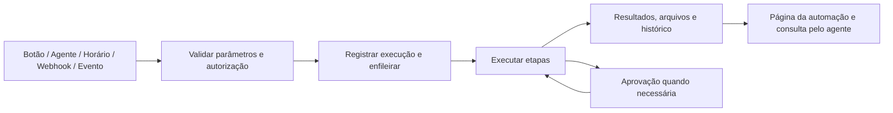

# Automações personalizadas por cliente

## 1. Proposta e decisões

Criar uma área **Automações** em que cada automação seja um recurso próprio do cliente: tenha página, parâmetros, regras de execução, gatilhos e histórico.

A primeira entrega combina uma base extensível com um piloto demonstrável de geração e envio de relatórios.

**Decisões confirmadas:**

- A equipe Tactia cria e publica as automações.
- O cliente configura os parâmetros liberados, executa e acompanha.
- As páginas combinam blocos configuráveis com componentes desenvolvidos sob medida.
- Botão, agente, agendamento, webhook e evento interno podem iniciar execuções.
- A autorização para efeitos externos é definida por automação.
- O piloto usa dados fictícios; a integração com um cliente real será especificada posteriormente.

A estrutura terá três partes independentes:

| Parte | Responsabilidade | Exemplo |
|---|---|---|
| Definição | Etapas, parâmetros, conexões e permissões | Gerar três relatórios e enviar por e-mail |
| Execução | Progresso, tentativas, resultados e evidências | Execução de setembro, iniciada pelo agente |
| Apresentação | Conteúdo e recursos da página | Filtros, tabela de relatórios, downloads e histórico |

## 2. Experiência do cliente e operação pelo Tactia Ops

### Catálogo e página própria

Adicionar **Automações** à navegação dos dois modos existentes do produto.

- `/automations`: cards com nome, finalidade, situação, última execução e próximo disparo agendado.
- `/automations/[id]`: página própria, com formulário de execução, conteúdo personalizado, resultados, gatilhos e histórico.
- `/automations/[id]/runs/[runId]`: execução compartilhável por URL, mostrando origem, parâmetros, etapas, arquivos, aprovações e falhas.

No piloto, a página apresenta período, seleção de relatórios, destinatário, botão **Executar**, acompanhamento das etapas e arquivos gerados.

### Personalização

Disponibilizar inicialmente blocos de formulário, indicadores, tabela, arquivos, progresso, histórico e ações. A configuração determina títulos, campos, colunas, organização e quais dados cada bloco apresenta.

Experiências específicas usam componentes registrados em código, identificados por uma chave versionada. Esses componentes recebem dados e ações pelo mesmo contrato da página padrão. Configurações salvas no banco não executam JavaScript arbitrário.

Reutilizar o design atual, com layout adaptado ao celular, operação por teclado, erros associados aos campos e anúncios acessíveis de progresso. Cobrir estados vazio, carregando, desabilitado, executando, aguardando aprovação, concluído, falhou e requer atenção. Atualizar execuções ativas por consulta periódica, preservando o acompanhamento ao recarregar a página.

### Gestão e permissões

Adicionar uma aba **Automações** no cliente dentro do Tactia Ops, permitindo criar rascunho a partir de um modelo, configurar, visualizar, testar, publicar e pausar.

- **Viewer:** consulta páginas, resultados e histórico.
- **Member:** também executa e cancela suas execuções.
- **Admin/owner:** também administra parâmetros liberados e gatilhos, aprova efeitos e cancela execuções da empresa.
- **Operador Tactia:** administra definição, conexões, apresentação e limites de autorização.

A criação técnica usa definições estruturadas e executores registrados em código. Editor visual de fluxos e criação autônoma pelo agente ficam para uma evolução posterior.

## 3. Definições, execução e integrações

### Modelo e versionamento

Adicionar entidades próprias para automação, versão publicada, execução, etapa executada, gatilho e artefato, todas com escopo de tenant.

Cada versão reúne schemas de entrada e saída, sequência de etapas, configuração da página e política de autorização. Cada execução fixa essa versão e uma cópia dos parâmetros resolvidos. Publicações posteriores não alteram trabalho em andamento.

Novas automações ficam em rascunho. Publicação torna a definição disponível; pausa bloqueia novos disparos e preserva as execuções existentes.

### Motor de execução

Implementar a orquestração em `packages/execution`, com serviços de domínio e persistência nas camadas existentes.

- Reutilizar PostgreSQL, `pg-boss`, credenciais, armazenamento e auditoria.
- Executar sequências de etapas com entradas validadas e referências explícitas aos resultados anteriores.
- Registrar tentativas, início, término, erro e saída por etapa.
- Reutilizar `BrowserExecutor` para workflows publicados e `ExecutionEngine` para ações com efeitos externos.
- Fixar também a revisão do workflow de navegador usada pela automação.
- Usar portas injetadas para preservar as dependências entre pacotes.

A primeira versão suporta sequências; condições complexas, laços e edição visual de grafos ficam fora desta entrega.

Toda solicitação retorna rapidamente um identificador de execução. O trabalho continua na fila, inclusive quando iniciado pelo Ops. O modo operacional exige workers habilitados.

### Recuperação e consistência

Persistir solicitações e mensagens de despacho de forma transacional, com uma outbox e um dispatcher recuperável. Assim, uma interrupção entre gravar a execução e publicar na fila não perde o trabalho.

Usar idempotência por disparo e por etapa, aquisição atômica de execução e bloqueio por conexão de navegador. Execuções que disputem a mesma conexão aguardam sua liberação.

Retomar da etapa incompleta, mantendo resultados confirmados. Aplicar tentativas automáticas apenas às operações classificadas como seguras. Cancelamento interrompe etapas futuras e solicita parada do executor ativo, preservando os efeitos já realizados.

Se houver dúvida sobre um envio externo ter ocorrido, marcar **Requer atenção** e impedir reenvio automático até reconciliação.

### Aprovações e e-mail

A política publicada determina efeitos, conexões e destinatários pré-autorizados. Casos válidos fora dessa pré-autorização geram aprovação; operações fora do escopo da automação são rejeitadas.

Reutilizar as aprovações existentes, vinculadas à etapa e ao conteúdo exato do efeito. A execução fica suspensa até aprovação ou rejeição. O servidor aplica a política independentemente de quem iniciou o disparo.

Estender o envio de e-mail com referências a artefatos do tenant. O backend resolve os arquivos e entrega seu conteúdo ao transporte; essa capacidade é suportada pelo [Nodemailer](https://nodemailer.com/message/attachments). Validar acesso, tamanho e tipo antes do envio.

Automações de produção exigem transporte real configurado. Sucesso significa aceitação pelo servidor SMTP, com identificador registrado; não comprova leitura ou entrega na caixa de entrada.

## 4. Gatilhos e contratos públicos

Todos os canais chamam o mesmo serviço de início, com validação, autorização, idempotência e registro de origem.

| Canal | Implementação inicial |
|---|---|
| Página | Formulário validado pelo schema da automação |
| Agente | Descobre automações disponíveis, consulta parâmetros, inicia e acompanha |
| Agendamento | Implementa o alvo `automation` já previsto em `Schedule` |
| Webhook | Endpoint por gatilho, assinatura HMAC, timestamp e identificador do evento |
| Evento interno | `sync.completed`, filtrado por conexão e somente para sucesso completo |

O evento interno será persistido junto à conclusão da sincronização. Não dependerá exclusivamente do callback atual, que também pode receber resultados parciais e tolera falhas.

**Interfaces novas:**

- API de catálogo, detalhe, criação de execução, consulta de histórico, cancelamento e retomada.
- API administrativa de rascunho, publicação, pausa, configurações e gatilhos.
- Ferramentas `list_automations`, `get_automation`, `run_automation` e `get_automation_run`, disponíveis aos agentes internos conforme as permissões do contexto.
- Contrato comum de resultado: identificador, estado, URL de acompanhamento, resumo e referências de artefatos.
- Campos de automação e parâmetros em `Schedule`, com vínculo entre ocorrência e execução.

O agente solicita parâmetros obrigatórios ausentes e retorna o link de acompanhamento sem aguardar a conclusão dentro da conversa.

Webhooks repetidos retornam a execução já criada; reutilizar um identificador com conteúdo diferente resulta em conflito. O tenant e a automação são resolvidos pela configuração autenticada do gatilho.

Agendamentos só contabilizam sucesso quando a automação termina com sucesso. Enfileiramento e espera por aprovação não contam como conclusão. O `effectMode` pode exigir aprovação adicional, mas nunca ampliar a autorização publicada.

## 5. Piloto, validação e entrega

### Piloto demonstrável

Criar um portal de teste com autenticação e três relatórios CSV de dados fictícios: vendas, estoque e financeiro. Usar um workflow publicado pelo adaptador Figranium existente, em ambiente isolado.

Fluxo:

1. Receber período, relatórios selecionados e destinatário.
2. Acessar o portal e exportar os arquivos.
3. Validar presença, formato e período de todos os relatórios solicitados.
4. Armazenar os resultados e disponibilizar downloads.
5. Enviar os anexos, ou aguardar aprovação conforme a política.
6. Registrar o resultado do envio.

Se a exportação ficar incompleta, preservar os arquivos obtidos e bloquear o envio. Se somente o envio falhar, a retomada reutiliza os relatórios já validados. O teste usa uma caixa SMTP local de captura.

### Critérios de aceite

- Os cinco canais iniciam execuções equivalentes e registram sua origem.
- Página padrão e variante sob medida funcionam com o mesmo contrato.
- Usuários, agentes, webhooks e downloads respeitam o isolamento entre tenants.
- Disparos duplicados e workers concorrentes não duplicam etapas confirmadas.
- Reinício do worker recupera trabalho pendente.
- Aprovação, rejeição, pausa, cancelamento e retomada produzem estados coerentes.
- Publicar uma nova versão não altera uma execução ativa.
- Falha ou resultado parcial da sincronização não dispara o evento de sucesso.
- Arquivos ausentes, SMTP indisponível e envio de resultado incerto não aparecem como sucesso.
- Agendamentos e ações existentes mantêm seu comportamento.

### Ordem de entrega

1. Persistência, versionamento, autorização e execução durável.
2. Piloto completo com navegador, arquivos, aprovação e e-mail.
3. Catálogo, páginas e gestão pelo Ops.
4. Integração dos cinco gatilhos e ferramentas dos agentes.
5. Testes de recuperação e isolamento, documentação e habilitação por tenant.

Começar habilitado somente no tenant de demonstração. Acompanhar fila, duração, falhas por etapa e execuções aguardando aprovação ou atenção. A implantação em cliente real depende da validação do sistema, relatórios e credenciais desse cliente.
